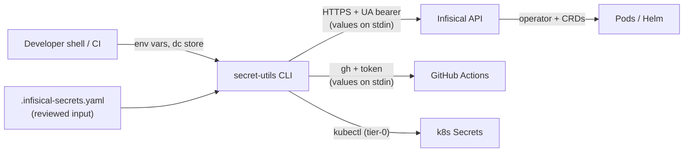

# Threat Model — k8/secret-utils

<!-- 〚📁:fb6be9ad-c6a8-5557-9a00-8f1f125b529c〛 THREAT-MODEL :: Threat model — trust boundaries, T-001–T-014 register, mitigations -->

## Overview

`secret-utils` is a **credential-moving** toolchain. Its crown jewels are the
secret *values* it resolves, transports, and writes — between the local
direnv-config store (`.envrc.dc`), the declarative `.infisical-secrets.yaml`,
the self-hosted Infisical API, GitHub Actions secret stores, and — for tier-0
bootstrap — raw Kubernetes Secrets. The package itself persists nothing: every
run is a stateless read-resolve-write cycle, so the risk concentrates in
**in-flight handling** (argv, stdin, logs) and in the **trust placed in
external endpoints** (Infisical host, GitHub, the cluster).

The dominant design principle is *never print or argv a value by default*, and
most controls in the register below are enforcement of that principle. This
model is derived from source structure and code paths only; it does not, and
must not, reproduce any secret value, payload, or key material.

## Trust Boundaries

1. **Local shell / env ↔ dc store** — `.envrc.dc` is encrypted at rest; reads
   must use `dc get … --reveal --raw`, and the redaction masks emitted without
   `--reveal` must never be mistaken for real values.
2. **CLI process ↔ Infisical API** — Universal Auth login → bearer; HTTPS to a
   host taken from config/env (`infisical.host`), optionally behind Cloudflare
   Access headers.
3. **CLI process ↔ GitHub API** — `gh` with a token; values written via stdin,
   targets restricted to a tracked owner allowlist.
4. **CLI process ↔ k8s API (tier-0)** — `kubectl create secret` for
   Infisical's own pre-operator Secrets.
5. **Config file ↔ engine** — `.infisical-secrets.yaml` is reviewed-but-untrusted
   input (it can name targets, templates, and fan-out destinations).
6. **Downstream** — Infisical operator + `InfisicalSecret` CRDs → k8s Secrets →
   pods (outside this repo, but the terminal consumer of every value).

## Attack Surface

Entry points: the CLI flags of every `bin/*` tool and the Rust subcommands;
the declarative YAML schema (`SecretSpec`, `github:` block); environment
variables for credentials and overrides; and the `.envrc.dc` / `dc` CLI the
tools shell out to. Egress: the configured Infisical host, GitHub, the
cluster, and PEM files read via `file:` specs.

## Vulnerability Register

| ID | Severity | STRIDE | Component | Status |
|----|----------|--------|-----------|--------|
| T-001 | High | Info disclosure | populate: Infisical write bodies via argv | Mitigated — `curl -d @-`, body on stdin |
| T-002 | High | Info disclosure | populate: `{{var\|urlencode}}` via `python3 -c` argv | Mitigated — value on stdin |
| T-003 | High | Tampering | `dc` redaction mask written as a real secret | Mitigated — `is_redaction_sentinel` refusal + `--reveal` required |
| T-004 | Medium | Tampering | Whole-file populate over-broad writes | Mitigated — `--all`/`--section` scope gate |
| T-005 | Medium | Tampering | YAML `<<` merge-key injecting a bogus secret | Mitigated — merge keys exploded; literal `<<` dropped |
| T-006 | High | Repudiation | Failed writes exiting 0 | Mitigated — failure counter + non-zero exit |
| T-007 | Medium | Tampering | Plan/apply drift for GitHub fan-out | Mitigated — plan-sha binding |
| T-008 | High | Info disclosure / Spoofing | GitHub fan-out to an attacker-owned target | Mitigated — tracked allowlist, anchor/alias refusal, identity assertion, canonical-repo checks |
| T-009 | High | Info disclosure | `infisical-bootstrap`: values in `kubectl --from-literal` argv | **Open** — see below |
| T-010 | Medium | Info disclosure | Sensitive flags (`--show-secrets`/`--show-diff`/`--show-values`) in logs/recordings | Partial — interactive-only, documented |
| T-011 | Medium | Info disclosure | Credential material at rest (dc store, env, `~/.local/lib`) | Accepted — dc-encrypted, `chmod 600` outputs |
| T-012 | Medium | Spoofing | Compromised / misconfigured Infisical host | Partial — config-driven, no host pinning |
| T-013 | Medium | Tampering | Supply chain (Rust crates, `jq`/`curl`/`openssl`/`gh`/`kubectl`/`dc`) | Partial — `Cargo.lock` pinned |
| T-014 | Low | Info disclosure | `hydrate-envrc` output readable by other users | Mitigated — `chmod 600` |

## T-009 — bootstrap argv exposure (open)

`bin/infisical-bootstrap` builds a `kubectl create secret generic …` command
whose `--from-literal=<KEY>="$value"` arguments carry live secret values in the
process **argv**. On a shared host, any local user who can read `ps` (or a
process-shape log/telemetry agent) can observe them during the run, and the
values also land in shell history if the command is copy-pasted. The other
write paths were hardened to stdin (T-001/T-002); this one was not.

Mitigating factors: it is a **one-time, tier-0** operation run by an operator on
a controlled box; the payload is exactly the set of Secrets Infisical needs to
boot. Recommended fix: pipe a `kubectl apply -f -` manifest (or
`--from-file` from an unlinked temp fs object) on stdin instead of
`--from-literal` argv. Until then, treat it as residual risk and run it from a
non-shared session.

## Mitigation Coverage

9 mitigated · 3 partial (T-010, T-012, T-013) · 1 open (T-009) · 1 accepted
(T-011). The open item has no ticket yet; it is recorded here as the tracking
locus.

- **Value handling** (T-001, T-002, T-003, T-006, T-014): enforced in
  `bin/infisical-populate-secrets`, `lib/secret-engine.sh`, `rust/src/dc.rs`,
  covered by `tests/test_populate_redaction.sh` and
  `tests/test_populate_safety.sh`.
- **Blast-radius control** (T-004, T-005, T-007, T-008): scope gate, merge-key
  hygiene, plan-sha, allowlist — covered by `tests/test_github_schema.sh` and
  `tests/test_github_writer.sh`.
- **Endpoint trust** (T-012, T-013): depend on operator configuration and
  dependency pinning; not enforceable inside the tool beyond `Cargo.lock`.

## Residual Risk

- **Interactive value flags** (T-010) remain, by design, for human debugging;
  `populate`'s `--show-secrets` is now a hard error, but the standalone
  `audit`/`fetch`/`rebuild`/`export` value flags still print values. Accepted:
  they are explicit opt-ins documented as SENSITIVE.
- **Local credential custody** (T-011): anyone who can read `.envrc.k8.dc` /
  the env can read every value the tool can. The tool adds no ACL beyond
  Infisical's own project permissions. Accepted.
- **Host trust** (T-012): the tool talks only to the configured
  `infisical.host` and has no baked-in fallback, but does not pin certificates.
  Accepted pending platform-level TLS policy.

## Related Docs

- [PROJ-ARCH.md](PROJ-ARCH.md) — components, data flow, trust-relevant design
- [PROJ-LAYOUT.md](PROJ-LAYOUT.md) — where each boundary-crossing component lives
- [PROJ-SCHEMA.md](PROJ-SCHEMA.md) — the `github:` and `SecretSpec` config surface
- [howto/sync-github-secrets.md](howto/sync-github-secrets.md) — the three gates
